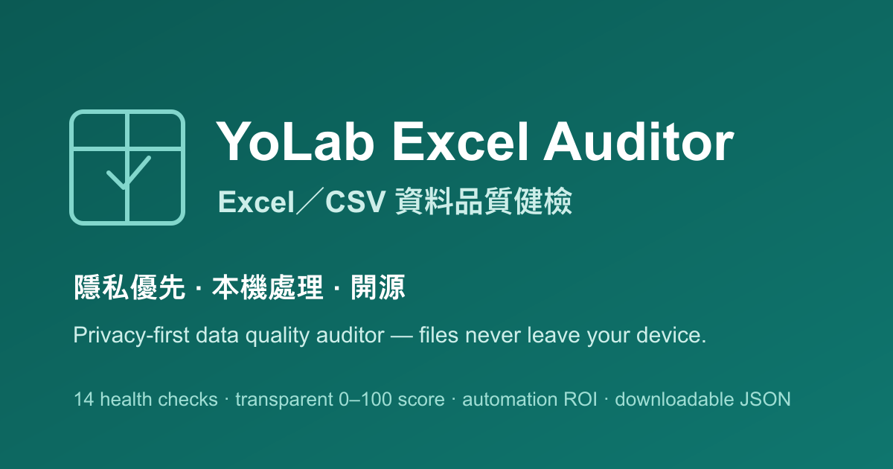
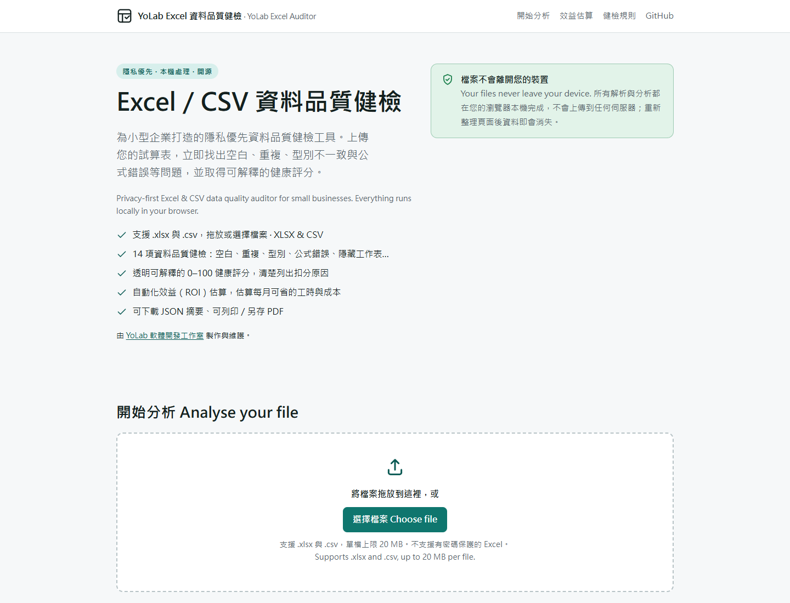
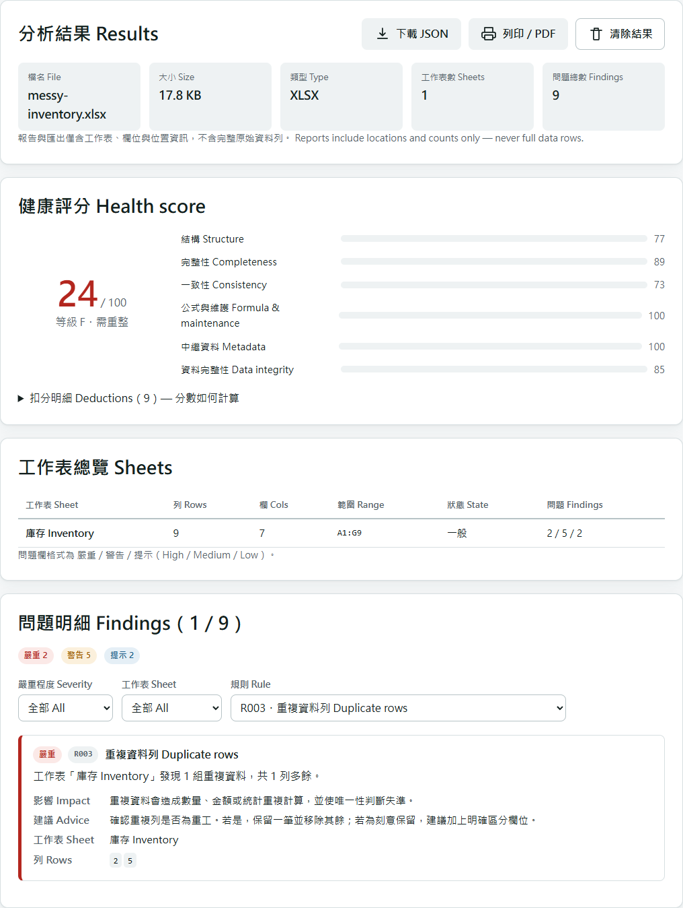

# YoLab Excel Auditor · Excel／CSV 資料品質健檢

> Privacy-first Excel and CSV data quality auditor for small businesses.
> 為小型企業打造的隱私優先 Excel／CSV 資料品質健檢工具。**所有分析都在您的瀏覽器本機完成，檔案不會上傳到任何伺服器。**

由 [YoLab 軟體開發工作室](https://yakitori197.github.io/YoLab/) 製作與維護 · MIT License

---

## 這是什麼 · What it does

上傳一份 `.xlsx` 或 `.csv`，工具會在您的瀏覽器內：

1. 解析工作簿並顯示檔名、大小、工作表數與資料範圍。
2. 執行 **14 項資料品質健檢**（空白、重複、型別不一致、公式錯誤、隱藏工作表…）。
3. 給出 **透明可解釋的 0–100 健康評分**，清楚列出每一項扣分原因。
4. 提供與檔案無關的 **自動化效益（ROI）估算**。
5. 可 **下載 JSON 摘要** 或 **列印／另存 PDF**。報告只含位置與統計資訊，不含完整原始資料列。

工具「只分析、給建議」，**不會修改您的原始檔案**。

## 功能截圖 · Screenshots



介面截圖（首頁與報告）放置於 [`docs/screenshots/`](docs/screenshots/)，擷取方式與注意事項見該資料夾說明。請一律使用 `samples/` 內的合成資料擷取，確保去識別化。

| 首頁與上傳 | 健康評分與問題明細 |
| --- | --- |
|  |  |

## 隱私承諾 · Privacy promise

- 檔案**只在**您的瀏覽器本機處理，**不會**傳送到任何伺服器。
- 沒有帳號、沒有後端、沒有資料庫、沒有 API Key。
- 沒有 Analytics、追蹤碼、遙測或廣告 SDK。
- 預設不保留上次分析；**重新整理頁面後資料即消失**（僅存在記憶體，未使用任何本機儲存）。
- 提供「清除結果」按鈕清空目前分析；此操作**不會**刪除您電腦上的原始檔。
- 匯出報告只含工作表、欄位與位置資訊，**不含完整原始資料列與電腦絕對路徑**。

詳見 [PRIVACY.md](PRIVACY.md)。

## 支援格式與限制 · Supported formats & limits

| 項目 | 說明 |
| --- | --- |
| 支援格式 | `.xlsx`、`.csv` |
| 檔案大小上限 | 20 MB（可於 `src/appInfo.ts` 調整） |
| 讀取上限 | 每份工作簿最多 64 張工作表；每張工作表最多 1,500,000 格；整份工作簿最多 3,000,000 格。超過即拒絕解析並顯示友善訊息，不靜默截斷。 |
| 不支援 | 有密碼保護的 Excel、`.xls`（舊二進位）、`.xlsm` 巨集執行 |
| CSV 編碼 | 支援 UTF-8（含 BOM）與 UTF-16；偵測到可能為 Big5 等非 UTF-8 時會提示改存 UTF-8 |

損壞檔案、錯誤副檔名、空檔案與解析失敗都會顯示友善訊息，不會讓頁面崩潰。

## 安裝與開發 · Getting started

需求：Node.js 22.13 以上的 22.x 或 Node.js 24 以上；CI 使用 Node.js 22。請使用 npm 10／11；npm 12 的首次安裝需要 `npm ci --allow-remote=root`，因為 SheetJS 使用專案明確指定的官方 CDN tarball。

```bash
npm ci             # 依 lockfile 安裝相依套件
npm run dev        # 啟動開發伺服器（http://localhost:5173）
npm run build      # 型別檢查 + 產生 dist/ 靜態網站
npm run preview    # 本機預覽 dist/
```

其他指令：

```bash
npm run lint             # ESLint
npm run typecheck        # TypeScript（strict, --noEmit）
npm test                 # Vitest 一次性執行
npm run generate:samples # 重新產生 samples/ 內的示範檔
```

## 測試 · Testing

核心分析邏輯與 UI 完全分離，並以 [Vitest](https://vitest.dev/) 覆蓋：

```bash
npm test
```

測試涵蓋：每一類健檢規則、空檔案、損壞／不支援檔案、多工作表、評分穩定性、ROI 計算、報告不含完整原始資料，以及以真實合成示範檔跑完整流程的整合測試。

瀏覽器測試使用 Playwright Chromium，在桌面與手機尺寸執行正式 build，並以 `/yolab-excel-auditor/` 子路徑驗證選檔／拖放、XLSX／CSV 分析、篩選、JSON 下載、清除／重新整理、錯誤復原、列印樣式及響應式版面：

```bash
npx playwright install chromium # 第一次安裝測試瀏覽器；Linux CI 使用 --with-deps
npm run build
npm run test:e2e
npm run screenshots            # 只重建 README 的兩張實際操作圖
```

測試只使用合成資料。CI 會保留 7 天的 HTML 報告、失敗 trace 與截圖；本機輸出位於 `playwright-report/`、`test-results/`。截圖細節見 [擷取說明](docs/screenshots/README.md)。

## GitHub Pages 部署 · Deployment

本專案為純靜態網站。GitHub Pages 自動部署已停用，push／合併 `main` 只執行 CI；網站保留既有發布版本。需要發布時，才由管理者手動執行：

1. 於 GitHub repo 的 **Settings → Pages → Build and deployment → Source** 選擇 **GitHub Actions**。
2. 在 Actions 頁面選擇 `Deploy to GitHub Pages`，於 `main` 手動執行 [`.github/workflows/deploy.yml`](.github/workflows/deploy.yml)，會先呼叫共用 [CI](.github/workflows/ci.yml)：安裝 → lint／型別檢查／單元測試／build／依賴稽核／瀏覽器測試。全部成功後才上傳剛剛驗證過的同一份 `dist/`，再部署。
3. 網站將發佈於 `https://<使用者>.github.io/<repo>/`。

PR 與 push／合併 `main` 只執行驗證，不部署。部署 workflow 僅保留 `workflow_dispatch`，不接受 push 觸發。部署 job 透過 `needs: verify` 等待驗證成功；任一檢查失敗就不會上傳 Pages 產物或部署。非 `main` 分支的手動部署也會跳過。Pages 寫入權限僅給部署 job。

Vite 的 `base` 設為 `'./'`（相對路徑），因此網站可在任意子路徑正常運作，不需自訂網域。

## 技術架構 · Architecture

- **框架**：React 18 + TypeScript（strict）+ Vite 8
- **測試**：Vitest 4 + Playwright（桌面／手機 Chromium）
- **XLSX 解析**：[SheetJS Community Edition](https://sheetjs.com/) `xlsx@0.20.3`（Apache-2.0，零相依）— 直接使用 **SheetJS 官方 CDN tarball**（非 npm 上已停更、含 CVE 的 `xlsx`），並以 lockfile 記錄完整性雜湊；詳見 [SECURITY.md](SECURITY.md)
- **CSV 解析**：[PapaParse](https://www.papaparse.com/)（MIT）
- **相依稽核**：CI 執行完整 `npm audit` 與 `npm audit --omit=dev`；公告會隨時間更新，請以當次 CI 結果為準。
- **樣式**：手寫 CSS（無大型 UI framework），支援明暗主題、響應式與列印版面
- **圖表**：未使用圖表套件；評分以純 CSS 長條呈現

```
src/
  core/            # 純分析邏輯（不含 React／DOM，可獨立測試）
    workbook/      #   解析器（SheetJS／PapaParse）＋ A1 位址工具＋錯誤型別
    rules/         #   14 條健檢規則 + 可擴充 registry
    scoring/       #   透明健康評分
    roi/           #   自動化效益估算
    report/        #   JSON 報告產生（保證不含原始資料列）
    analyze.ts     #   規則引擎協調器
  ui/              # React 介面（sections／components）
  appInfo.ts       # 共用常數（版本、連結、大小上限）
samples/           # 完全虛構的示範檔 + 產生腳本
```

新增一條健檢規則，只需實作 `RuleDefinition` 介面並加入 `src/core/rules/registry.ts`，引擎與 UI 會自動套用。

## 健檢規則 · Health checks

| 代碼 | 名稱 | 分類 | 說明 |
| --- | --- | --- | --- |
| R001 | 空白欄位比例 | 完整性 | 資料區空白儲存格比例過高 |
| R002 | 完全空白的列或欄 | 完整性 | 整列或整欄皆空白，切斷資料範圍 |
| R003 | 重複資料列 | 結構 | 內容完全相同的重複列 |
| R004 | 重複或空白欄名 | 結構 | 標題列有空白或重複欄名 |
| R005 | 欄位混合資料型別 | 一致性 | 同欄混用文字／數值／日期 |
| R006 | 日期格式不一致 | 一致性 | 同欄混用多種日期格式 |
| R007 | 數值儲存為文字 | 一致性 | 應為數值卻以文字儲存（僅 XLSX） |
| R008 | 前後多餘空白 | 一致性 | 文字前後多餘空白造成比對失敗 |
| R009 | 公式錯誤值 | 公式與維護 | `#DIV/0!`、`#N/A`、`#REF!` 等錯誤值 |
| R010 | 大量公式維護風險 | 公式與維護 | 公式數量偏高、人工維護風險 |
| R011 | 合併儲存格 | 結構 | 合併破壞表格方正結構 |
| R012 | 隱藏工作表 | 中繼資料 | 隱藏工作表可能藏有遺忘或敏感內容 |
| R013 | 資料量異常大的工作表 | 中繼資料 | 列數／儲存格數過大 |
| R014 | 疑似唯一識別欄位出現重複 | 資料完整性 | 疑似主鍵（編號、代碼）出現重複值 |

**評分方式**：起始 100 分，每項問題依嚴重程度固定扣分（嚴重 15、警告 8、提示 3），每個分類最多扣 40 分，最後夾在 0–100。完全透明、可重現、無隨機或不可解釋的 AI 評分。

## 示範資料 · Demo data

`samples/` 內的檔案皆為 **完全虛構的合成資料**（無真實公司、人名、電話、Email、地址、統編或產品），由 [`samples/generate-samples.mjs`](samples/generate-samples.mjs) 產生，可隨時 `npm run generate:samples` 重建以稽核來源。詳見 [samples/README.md](samples/README.md)。

## 貢獻與安全 · Contributing & security

- 貢獻方式請見 [CONTRIBUTING.md](CONTRIBUTING.md)。
- 安全性回報請見 [SECURITY.md](SECURITY.md)。
- 版本紀錄請見 [CHANGELOG.md](CHANGELOG.md)。

## 授權 · License

[MIT](LICENSE) © 2026 YoLab 軟體開發工作室
